# Conductor — Application Guide

Conductor is a Jira-style application lifecycle management (ALM) platform. Teams use it to track work in projects (stories, tasks, defects, epics), move that work through configurable workflows, search it with JQL, plan it into program increments and report on it. A **service desk** lets customers raise requests in a branded **help center** while agents work them from queues against SLAs. **Service notices**, **automation rules**, **webhooks** (including Slack and Microsoft Teams), **incoming webhooks** and **API tokens** connect it to the rest of the organisation, and the whole app works on a phone.

On top of the standard features, Conductor supports the **SPORTS conventions**: a strict issue hierarchy, SPORTS-specific issue types (Feature/BAU/Release epics, release candidates, code/test/deployment sub-tasks), team and service component naming rules, RAG status, incident escalation and PI scheduling.

> Screenshots were taken from a fresh instance loaded with the demo data (`npm run db:seed:demo`) plus a few sample automation rules, webhooks and API tokens, logged in as `admin@conductor.local` (help center screens as the customer `anna@customer.local`). Desktop screenshots are 1440 px wide; phone screenshots are 390 px wide.

---

## Contents

**Part 1 — Overview**

1. [Feature map](#1-feature-map)
2. [Architecture and deployment](#2-architecture-and-deployment)
3. [Core concepts](#3-core-concepts)

**Part 2 — Everyday work**

4. [Signing in](#4-signing-in)
5. [The global header](#5-the-global-header)
6. [Board](#6-board)
7. [Creating issues](#7-creating-issues)
8. [Issues: search, JQL, filters and bulk changes](#8-issues-search-jql-filters-and-bulk-changes)
9. [Issue detail](#9-issue-detail)
10. [SPORTS features on an issue](#10-sports-features-on-an-issue)

**Part 3 — Projects, planning and reporting**

11. [Projects](#11-projects)
12. [Project settings](#12-project-settings)
13. [Planning (program increments)](#13-planning-program-increments)
14. [Dashboard](#14-dashboard)
15. [Reports](#15-reports)

**Part 4 — Service desk**

16. [Service desk and help center](#16-service-desk-and-help-center)

**Part 5 — Communication**

17. [Notifications](#17-notifications)
18. [Email settings and email notifications](#18-email-settings-and-email-notifications)
19. [Service notices](#19-service-notices)

**Part 6 — People**

20. [People, organizations and recipient groups](#20-people-organizations-and-recipient-groups)

**Part 7 — Integrations**

21. [Automation rules](#21-automation-rules)
22. [Webhooks, Slack and Microsoft Teams](#22-webhooks-slack-and-microsoft-teams)
23. [Incoming webhooks](#23-incoming-webhooks)
24. [API tokens and the API reference](#24-api-tokens-and-the-api-reference)

**Part 8 — Mobile**

25. [Using Conductor on a phone](#25-using-conductor-on-a-phone)

**Part 9 — Reference**

26. [Permissions reference](#26-permissions-reference)
27. [JQL reference](#27-jql-reference)
28. [Capabilities available through the API only](#28-capabilities-available-through-the-api-only)
29. [Screen index](#29-screen-index)

---

## 1. Feature map

| Area | What it covers | Where |
|---|---|---|
| **Work tracking** | Projects, issues, sub-tasks, epics, links, comments, attachments, work logs, history, watchers | Board, Issues, issue page |
| **Board** | Kanban columns per status; drag to transition; edit cards in place; side panel | Board |
| **Search** | Basic filters, JQL, saved and shared filters, CSV export, bulk changes | Issues |
| **Workflows** | Per-project statuses, categories, transition matrix, resolutions | Project page |
| **SPORTS** | Strict hierarchy, RAG, custom fields, incident escalation, release epics, PI scheduling | SPORTS project, Planning |
| **Reporting** | Plan-progress dashboard; status, timeline, priority, open-issue and SLA reports; A4 PDF | Dashboards, Reports |
| **Service desk** | Request types, queues, SLAs, internal notes, portals per client company, email channel | Queues, project page, help center |
| **Communication** | In-app and email notifications, per-project email scheme, service notices | Bell, Notices, Administration |
| **People** | Staff, customers, organizations, recipient groups, welcome and reset emails | People |
| **Integrations** | Automation rules, webhooks, Slack/Teams, incoming webhooks, API tokens, OpenAPI reference | Profile menu → Integrations |
| **Mobile** | Responsive layout for every screen, including the help center | Any phone browser |

---

## 2. Architecture and deployment

| Layer | Technology | Notes |
|---|---|---|
| Frontend | React, Vite, TypeScript, Tailwind CSS, TanStack Query | Single-page app on port **5172** in development |
| Backend | NestJS (REST API under `/api`) | Port **3000**; in production it also serves the built frontend |
| Database | Prisma ORM with **SQLite** (default) or **PostgreSQL** | Chosen by `DATABASE_URL` in `backend/.env` |
| Auth | JWT for people (7-day expiry by default); API tokens (`jt_…`) for scripts | |
| Email out | Gmail API, SMTP, or `.eml` files in `backend/mail-outbox/` | Set in Email settings (section 18) |
| Email in | IMAP mailbox per service desk | Section 16 |
| Background jobs | Mailbox polling, webhook retries, scheduled automation rules | Each can be switched off per instance |
| PDF | jsPDF, generated in the browser | Reports |
| API docs | OpenAPI 3 + Swagger UI | `/api/docs`, `/api/openapi.json` |

Each backend module maps to a feature area: `auth`, `projects`, `issues` (incl. bulk and move), `workflow`, `search` (JQL), `board`, `notifications` (incl. the email notification scheme), `versions`, `components`, `labels`, `custom-fields`, `planning`, `scheduling`, `releases`, `incidents`, `dashboard`, `reports`, `users`, `organizations`, `recipient-groups`, `access` (project permissions), `service-desk` (request types, queues, SLAs, portals and the help center), `issue-email`, `service-notices`, `automation`, `webhooks`, `inbound-webhooks` and `api-tokens`.

Project-scoped requests carry the current project in the `X-Project-Key` header, so every screen works on the project selected in the header.

**Running it**

| | Command |
|---|---|
| Install and set up | `npm install`, `cp backend/.env.example backend/.env`, `npm run db:push -w backend`, `npm run db:seed` |
| Demo data | `npm run db:seed:demo` (safe to run repeatedly) |
| Development | `npm run dev` (API :3000, UI :5172) |
| Production | `npm run build`, then `npm start`: syncs the schema, runs both seeds and starts the API, which serves the UI |

**Render.** `render.yaml` is a Render Blueprint: one Node web service (API and built UI) backed by a Render PostgreSQL database, with a generated `JWT_SECRET`. *New → Blueprint* in Render deploys it. Because `npm start` runs the (idempotent) demo seed on every start, a free instance whose database is reset comes back populated. Settings that must survive a reset can be given as environment variables: the Gmail sender (`GMAIL_*`) and each service desk's mailbox (`EMAIL_<KEY>_*`).

---

## 3. Core concepts

**Project** — a container for issues, with a unique key (`PAY`, `MOB`, `SPORTS`, `HELP`). Issues are numbered `KEY-1`, `KEY-2`, … Every project has its own versions, components, custom fields, workflow, members and (optionally) email notification scheme.

**Project types**
- *Software* — boards, epics, versions and releases; free hierarchy and free component naming.
- *Software with SPORTS conventions* — *Enforce SPORTS conventions* ticked at creation. Stories, tasks and defects must sit under an epic, and components must follow the naming rules (team components start with `@`, service / release-train components use `ASSETID (serviceName)`).
- *Service desk* — customers raise requests in a help center; agents work queues with SLAs. See [section 16](#16-service-desk-and-help-center).

**Issue types and hierarchy**

| Level | Types |
|---|---|
| Epics (top level) | Epic, Feature Epic, BAU Epic, Release Epic |
| Level 2 | Story, Defect, Task, Release Candidate |
| Sub-tasks | Analysis, Bug Fix, Code, Code Review, Arch Review, Code Merge, Documentation, Test Case, Test Run, Deployment, Configuration, Sub-task |

Parent rules are enforced by the server — for example, a *Release Candidate* can only sit under a *Release Epic*, *Code* only under a *Story*, and a *Defect* can sit under an epic or a story. A child issue is always created in its parent's project.

**Statuses and categories** — each project's workflow has its own statuses (e.g. *In Review*, *QA*, *Waiting for customer*), and every status belongs to one of four categories: **Backlog, To Do, In Progress, Done**. Dashboards, reports and the `statusCategory` JQL field use the category. New software projects start with Backlog → To Do → In Progress → Closed.

**Resolution** — moving an issue into a Done status requires a resolution (*Done* or *Won't do*). Re-opening clears it.

**Priority** — Highest, High, Medium, Low, Lowest. For defects, the SPORTS rules derive priority from a severity × impact matrix.

**Who's who** — *staff* use the main app; *customers* (the Customer role) only ever see the help center. Inside a project, staff have a project role (Administrator, Member, Viewer); see [section 26](#26-permissions-reference).

---

## 4. Signing in


Sign in with email and password. A successful login stores a JWT in the browser; signing out (profile menu) clears it. Staff land on the board, customers in the help center. Accounts are created by an administrator on the **People** page — there is no self-registration. New people get a welcome email with a link to choose their own password ([section 20](#20-people-organizations-and-recipient-groups)).

**Forgot password?** (next to the password field) opens `/forgot-password`. Enter your email and, if it has an account, you get a *Reset your Conductor password* email with a link to choose a new one on the same page as welcome links:

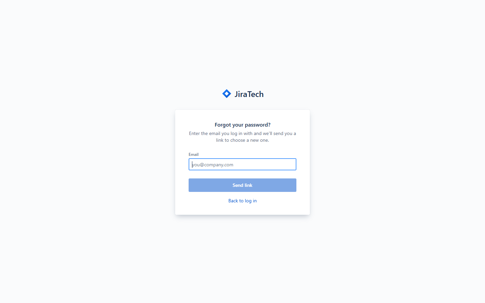

- The link works for **60 minutes** and **once**; asking again within a minute sends nothing more. A new link cancels the previous one.
- The page always answers *Check your email*, whether or not the address has an account, so it can't be used to find out who has one.
- Your old password keeps working until you save the new one; saving logs you in.
- An expired or used link offers *Get a new link*:

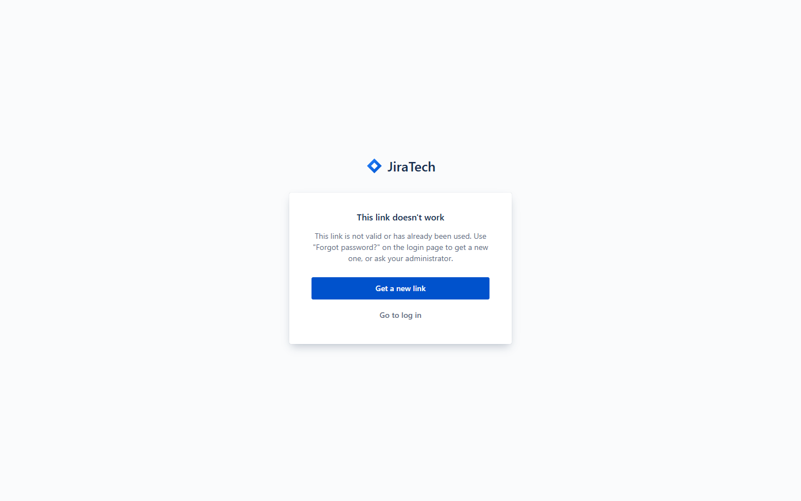

Default administrator: `admin@conductor.local` / `admin123`. Demo users (after `db:seed:demo`) share the same password, e.g. `elena@` (team lead), `nikos@` (developer), `sofia@` (QA), `daniel@` (release manager), `katerina@` (product owner); customers `anna@customer.local` and `peter@customer.local` (Acme Retail) and `george@customer.local` (Globex).

---

## 5. The global header

Every staff page shares one header:

| Element | What it does |
|---|---|
| **Logo** | Back to the board |
| **Project switcher** | Shows the current project; switches project, links to all projects or *Create project* |
| **Navigation** | Board · Queues (service desk projects) · Issues · Projects · Planning · Dashboards · Reports · Notices · People |
| **Create** | Opens the Create issue dialog |
| **Help center** (speech-bubble icon) | Opens the customer help center in a new window |
| **Search** | Quick search across issues and projects (press `/` from anywhere) |
| **Bell** | Notifications, with an unread badge (refreshes every 30 s) |
| **Avatar** | Profile menu (below) |

**Profile menu**


- Name, email and global role.
- **Email notifications** switch — your personal on/off for notification emails (in-app notifications are always on).
- **Administration** (global admins): Email settings, Email templates, Email notifications ([section 18](#18-email-settings-and-email-notifications)).
- **Integrations** (global admins, and project administrators for their own projects): Automation, Webhooks, Incoming webhooks ([Part 7](#21-automation-rules)).
- **API tokens** (all staff), **Help center**, **Log out**.

**Project switcher**


**Quick search** — type a key or words; matching issues appear as you type, and *Search all issues for "…"* opens the full Issues page with that text.


On narrower screens the navigation folds into a menu button and quick search becomes an icon ([section 25](#25-using-conductor-on-a-phone)).

---

## 6. Board

The home page is the Kanban board of the current project.


- One column per workflow status, with a count in each header.
- Each card shows summary, components, issue type icon, key, priority icon, assignee avatar, and a **BLOCKED** flag or RAG dot when set. Closed issues have their key struck through.
- **Drag a card to another column** to change its status. Only moves allowed by the workflow are accepted; dropping into a Done column asks for a resolution (*Done* or *Won't do*) first.
- **Search this board** filters cards by text; **Only my issues** shows issues assigned to you.
- **View all issues** opens the Issues page for the project.

### Editing from the board

People who can edit issues in the project can change them without leaving the board:

| Action | How |
|---|---|
| Change priority or assignee | Click the card's priority icon or avatar |
| Edit the summary in place | The pencil on the card, or select the card and press **F2** |
| Quick actions | The card's **•••** button or **right-click**: Edit all fields, Edit summary, Open issue page, Copy link, *Move to* a status (with Done / Won't do for Done statuses), Assign to me / to someone / Unassign, Priority, RAG and Blocked |
| Edit every field | Click the card: a **side panel** opens with the status, description and all fields. It is kept in the URL (`?issue=PAY-4`), so it survives a reload and *Back* closes it; *Open full page* goes to the issue page |

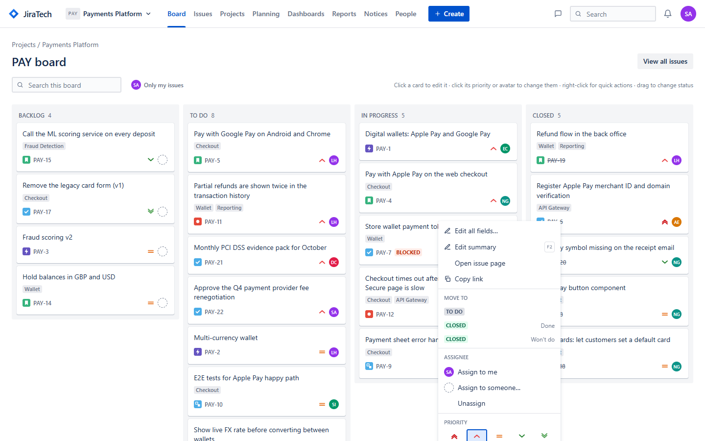

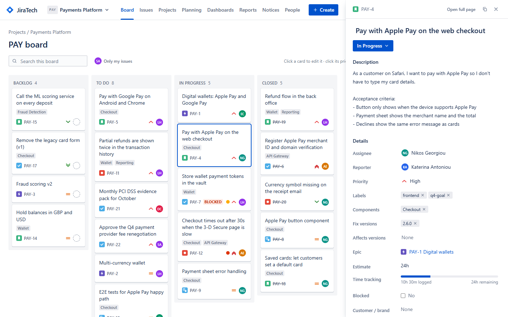

The SPORTS board looks the same, with the SPORTS issue types and @team components:


---

## 7. Creating issues

Click **Create** in the header (or *Add child issue* / *Create sub-task* from an issue).


| Field | Notes |
|---|---|
| Project \* | Only projects where you are a Member or Administrator |
| Issue type \* | All types; the list of valid parents depends on the type |
| Summary \* | |
| Epic name | Shown for epic types |
| Description | Rich text: bold, italic, strikethrough, inline code, heading, lists, quote, code block, link, `@` mention |
| Parent | Type-ahead search for an epic or story. Required in SPORTS-convention projects for level-2 types |
| Assignee, Priority | Priority defaults to Medium |
| Labels | Pick existing labels or create new ones inline |
| Original estimate (hours) | Used by time tracking and the PI scheduler |
| Components, Fix versions | From the project's settings |
| Create another | Keeps the dialog open for the next issue |

Mentioning someone with `@` in the description notifies them and adds them as a watcher. Issues can also be created by automation rules, incoming webhooks, service desk emails and the help center.

---

## 8. Issues: search, JQL, filters and bulk changes

The **Issues** page is the search hub.

### Basic search


Filter by text, project, type, status, assignee and other dropdowns. The left sidebar (behind a *Filters* toggle on phones) holds:
- **Filters** — built-in: My open issues, Reported by me, All issues, Open issues, Done issues, Updated recently.
- **Saved filters** — your own (starred).
- **Shared with you** — filters other people have shared.

### JQL search

Click **Switch to JQL** to write queries directly. The help line under the box lists fields, operators, functions and date formats.


- Click column headers to sort; results are paged.
- **Save as** stores the query as a saved filter, optionally shared.
- **Export** downloads the results as CSV.
- Search results only include issues you're allowed to see.

### Bulk changes

Tick issues (or the header checkbox for the whole page) to get the bulk toolbar.


| Action | What it does |
|---|---|
| **Edit** | Set assignee, priority, labels, components or fix versions |
| **Change status** | Move to a status (asks for a resolution when moving to Done) |
| **Watch** | Start watching all selected issues |
| **Move** | Move the selected issues to another project ([section 9](#moving-an-issue-to-another-project)); statuses are matched automatically |
| **Delete** | Delete the selected issues |

Every issue is checked individually against permissions and the workflow; anything that can't be changed is listed afterwards with the reason. Untick *Send notifications* for quiet clean-ups.

---

## 9. Issue detail

Open any issue at `/browse/KEY-123` (from the board, search, a link or a notification).


**Header** — breadcrumbs (project / epic / issue), watch button with watcher count, copy link, and a **•••** menu (Log time, Create sub-task, Link issue, Move to another project, Copy link, Delete).

**Main column**
- **Attach / Add child issue / Link issue** quick actions. Attachments can be downloaded and deleted.
- **Description** — rich text, edited in place.
- **Child issues** — list with statuses and a progress bar (% of children done).
- **Linked issues** — grouped by link type: *blocks / is blocked by / depends on / relates to*. Links can cross projects; add with type-ahead search, remove from the list.
- **Activity** — tabs:
  - **Comments** — add, edit and delete; supports rich text and `@mentions`.
  - **Emails** (service desk requests) — emails received and sent on the request ([section 16](#emails-on-a-request)).
  - **History** — every field change, transition, link and attachment, with old → new values.
  - **Work log** — time logged by each person with a note.


**Side panel**
- **Status button** — shows the current status; the dropdown lists only transitions the workflow allows (including *Re-open* from Done). Moving to Done asks for a resolution.
- **Service request** (service desk projects) — portal, request type, how it was raised, customer, organization, both SLA clocks and who it's shared with.
- **Details** — Assignee, Reporter, Priority, Labels, Components, Fix / Affects versions, Epic, Estimate, **Time tracking** (logged vs. remaining bar), **Blocked** flag, plus the project's **custom fields**. All fields edit in place.
- **Watchers** — list, *Watch / Stop watching*, *Add watcher*.
- Created / updated timestamps.

Opening an issue marks its notifications as read. Deleting an issue removes its comments, history, links, work logs and attachments; issues with children must have them moved or deleted first.

### Moving an issue to another project

**••• → Move to another project** (needs member access in both projects) moves the issue, with all its sub-tasks, as Jira does:

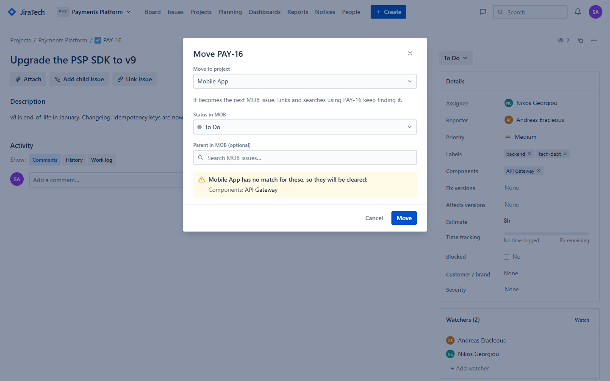

- Each issue gets the next key of the target project. **The old key keeps working**: `/browse/OLD-12`, search (`key = OLD-12`), the help center and email replies quoting it all find the issue.
- You choose its **status** in the target workflow (preset to the status of the same name, else the first one of the same category); sub-tasks are matched the same way. Moving into Done keeps the resolution (or sets *Done*).
- You can pick a **parent** in the target project; projects with strict hierarchy require one for everything except epics. The old parent stays behind.
- **Components, versions and custom fields** carry over when the target has one of the same name (key, for custom fields); **labels** are created there if missing. Sprint and program increment are cleared. The dialog lists everything that would be cleared before you confirm.
- Service desks: the request type is matched by name (or by issue type), and the organization is kept when the target serves it.
- Comments, attachments, work logs, links, watchers and history move with the issue; the history records the old and new project and key.

---

## 10. SPORTS features on an issue

In the SPORTS project, issues carry extra fields and actions.


**RAG status** — Green / Amber / Red selector (also in the board's quick actions). Amber and red issues appear under *At risk or delayed* on the dashboard.

**SPORTS custom fields** — Priority Justification (YBET / Critical / Standard), [pts] Customer, Customer Account, [pts] Target Version/s, Progress Status, Reopen Count (maintained automatically), CACHED Inherited Account. Projects can define their own custom fields (text, number, select, date, user, version).

**Incident handling** (Defects and Tasks) — the *Incident handling* section offers:

| Action | Effect |
|---|---|
| **Escalate to @TEAM** | Adds that team component to the issue |
| **De-escalate** | Removes a team component (API) |
| **Refuse** | The current team hands the issue back (removes its component) |
| **Reject** | Closes the issue with resolution *Rejected* |
| **Re-open** | Moves it back to In Progress and increments *Reopen Count* |

Every action is logged as an escalation event, and the latest ones appear under *Recent escalations* on the dashboard.

**Release epics** — a Release Epic groups the release candidates (RC builds), regression test runs and deployments for one release:


---

## 11. Projects


Lists every project you can see, with key, type (Software / SPORTS conventions / Service desk), general access (Open / Limited / Private), your role, lead and issue count. **Switch to** makes a project current; the current one is marked **CURRENT**. Search narrows the list.

**Create project** (only people with the global role Admin, Project Manager, Program Manager or Product Manager):


Choose the type (**Software** or **Service desk**), then Name, Key (2–10 letters/digits, starting with a letter; can't be changed later), Description, Project lead and, for software projects, the *Enforce SPORTS conventions* checkbox.

---

## 12. Project settings

Click a project name to open its page. Administrators see edit controls; everyone else sees a read-only view.


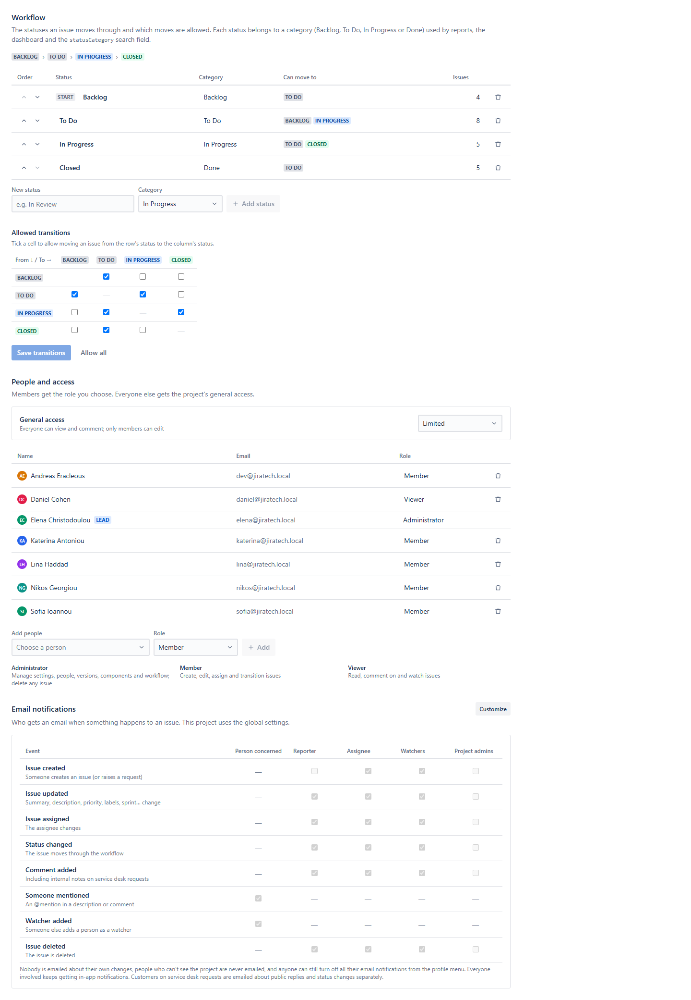

| Section | Contents |
|---|---|
| **Header** | Name, key, description; *View issues*, *Board*, *Edit details* (name, description, lead) |
| **Status overview** | Bar and counts per status category; each count links to a filtered search |
| **Versions** | Name, released / unreleased, release date; *Release* / *Unrelease*; add a version |
| **Components** | Name, type (Service, Team, Release train), lead; add a component (SPORTS naming rules apply in SPORTS projects) |
| **Service desk** (service desks only) | Portals, email address, email templates, request types, SLA goals and queues ([section 16](#16-service-desk-and-help-center)) |
| **Workflow** | Statuses in order with category, allowed next statuses and issue count. Add, rename, recategorise, reorder and delete statuses. The **Allowed transitions** matrix sets which moves are permitted (*Allow all* for a free workflow). Service desks also mark which statuses **pause the SLA** |
| **People and access** | General access level, members with their project role, add/remove people |
| **Email notifications** | Who is emailed about issue events in this project: the global settings, or the project's own ([section 18](#who-is-emailed-about-issue-events)) |
| **Details** (side) | Key, lead, issue count, rules, access, your role, created date |
| **Quick filters** (side) | My open issues, Reported by me, Unassigned, Updated in the last 7 days |

---

## 13. Planning (program increments)


- **PI cards** — each program increment with status (Planning / Active / Completed), date range, issue and sprint counts. Click to select.
- **Sprints** in the selected PI.
- **Issues in the PI** — type, key, summary, status, estimate and scheduled dates.
- **Run scheduler** — orders the PI's issues by priority and type, respects *depends on* links (an issue starts after what it depends on), and fits them into team capacity (by component; 40 h default per team; missing estimates count as 8 h). It writes scheduled start/end dates and shows a summary: *Scheduled*, *Unscheduled*, and *Constraint violations* (e.g. "insufficient capacity for team @DB").

> Running the scheduler updates the scheduled dates on the PI's issues.

---

## 14. Dashboard

Plan-progress dashboard for the current project.


- **Totals** — total issues, in progress, closed, completion %.
- **Issues by status** and **RAG status** bar charts.
- **Blocked** — issues flagged as blocked, with assignee.
- **At risk or delayed** — amber and red issues.
- **Recent escalations** — latest incident actions (shown when there are any).

---

## 15. Reports

Four management reports for the current project over a chosen period (From / To dates, or *Last 3 / 6 / 12 months*), plus an **SLA performance** report for service desk projects. **Download PDF** produces an A4 PDF with all of them, each starting on a new page.

**Status dashboard** — Monthly Project Status Report: project, report date, overall status, % complete; donuts for issue status, type and priority; pending items by type; closed by last assignee; closed per month (stories, bugs, tasks) over 12 months.


**Issue timeline** — the 10 longest-open bugs, stories and epics, drawn as bars from creation date to today, coloured by status category.


**Priority analysis** — open issues by priority, plus the full list of open Highest and High issues.


**Open issues** — every open issue in the period with key, summary, type, status, priority, assignee and age.


**SLA performance** (service desk projects only) — for requests raised in the period: requests, % meeting the first-response and resolution goals, and open requests already breached; a donut per clock (met, missed, breached while open, at risk, on track, paused) with the average time once each clock stopped; compliance by portal and by priority (goal vs. average time, % met — green from 90%, amber from 70%, red below); the resolution SLA met vs. missed per month over 12 months (by resolution date); and a table of open requests that are breached or have under a quarter of their goal left, most urgent first. "% met" counts met against missed or already breached; clocks still running don't count yet.

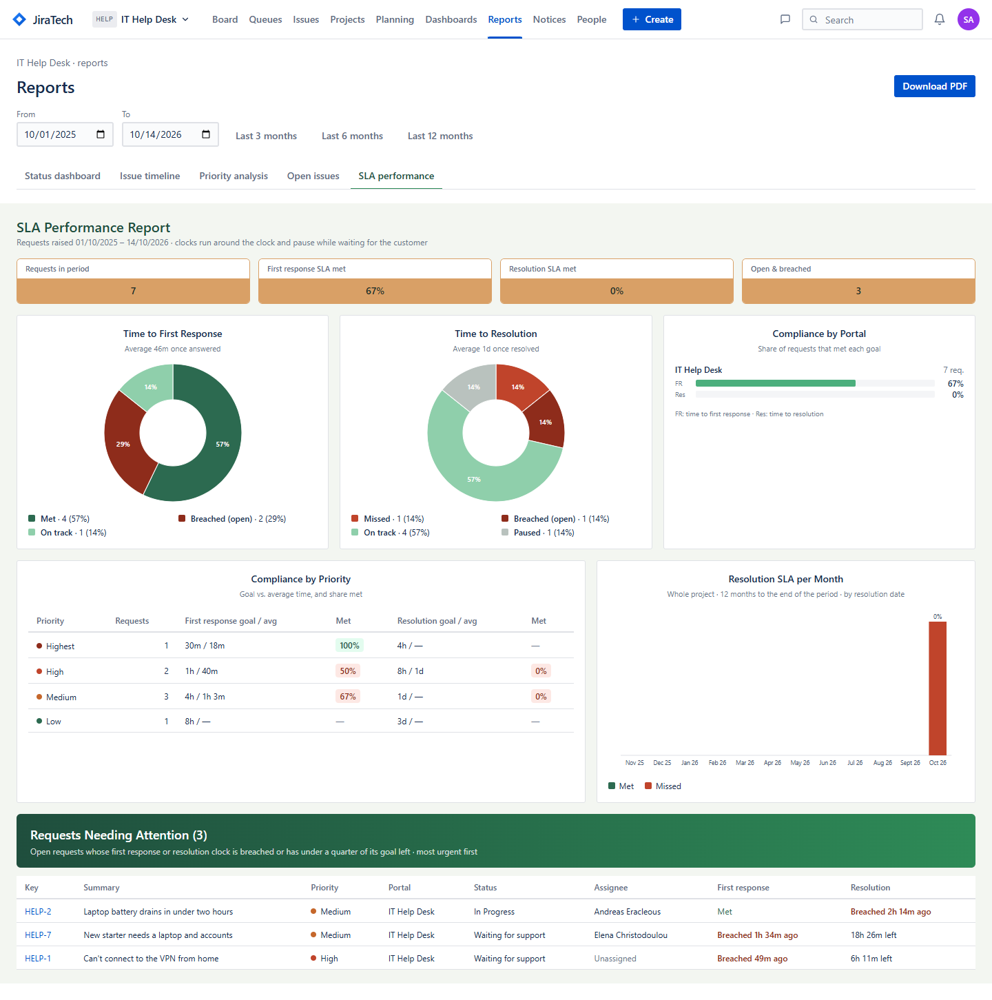

---

## 16. Service desk and help center

A **service desk** project handles requests from **customers**: people outside the delivery teams who raise requests in a simple **help center** and follow them there. The project's members are the **agents**, who work the requests from **queues** against **SLA** goals.

### Setting one up

Choose **Service desk** as the project type in **Create project**. The new project starts with:

| | Default |
|---|---|
| Workflow | Waiting for support → In Progress → Waiting for customer → Resolved (*Waiting for customer* pauses SLAs) |
| Request types | Get IT help, Report a bug, Request access, Suggest an improvement |
| SLA goals | First response / resolution: Highest 30m / 4h · High 1h / 8h · Medium 4h / 24h · Low 8h / 72h · Lowest 24h / 120h |
| Queues | All open · Unassigned · Assigned to me · Waiting for customer · Resolved in the last 7 days |

Project administrators change all of it in the **Service desk** section of the project page (`/projects/KEY#service-desk`):

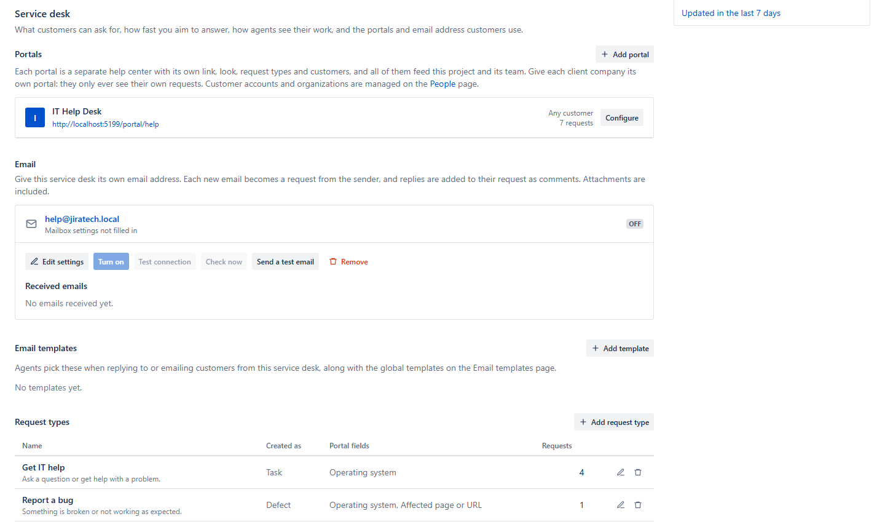

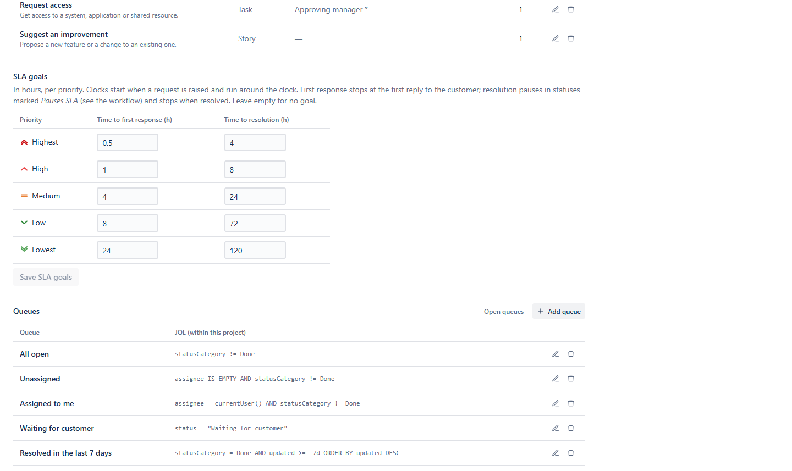

- **Portals**: the project's customer-facing help centers (see below). Each has a name and link, who may use it, the request types it offers, and its **look and feel**: logo (PNG, JPEG, GIF, WebP or SVG up to 256 KB), accent colour and welcome message, with a live preview.
- **Email**: the desk's own email address (see below).
- **Email templates**: the desk's own reply templates (see *Emails on a request*).
- **Request types**: what customers can ask for, the issue type each one creates, and which project fields the portal form asks for (text, number, select or date; each can be required). New fields can be created right in the dialog.
- **SLA goals**: hours per priority for *time to first response* and *time to resolution*; leave a box empty for no goal.
- **Queues**: named JQL filters, always limited to the project. Without `ORDER BY`, the request closest to breaching comes first.
- **Workflow**: the *Pauses SLA* column marks statuses where the resolution clock stops (e.g. *Waiting for customer*).

### Agents

- **Queues** (`/queues`, in the header when the current project is a service desk): each queue's requests with status, *First response* and *Resolution* SLA badges (blue on track, amber under 25% left, red breached, grey paused, green met), reporter, assignee and organization. Refreshes every minute. *Raise a request* creates one on behalf of a customer (e.g. one who phoned in).

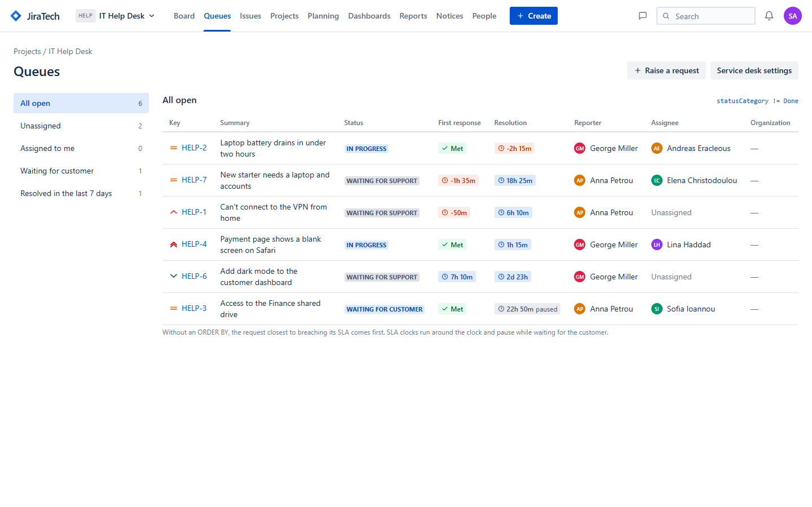

- **Issue page**: a **Service request** panel with the portal, request type, how it was raised, the customer, both SLA clocks and the customers it's shared with (add more with *Share with a customer*); *View in help center* shows it as the customer sees it.
- **Comments**: choose **Reply to customer** (customers see it and are notified) or **Add internal note** (agents only, shown in yellow). The first reply to the customer stops the first-response clock.
- **Emails** (see below): answer customers by email from the request, with templates.
- **JQL**: `requestType = "Report a bug"` finds requests of a type; `organization = "Acme Retail"` those shared with an organization; `portal = acme` those raised through a portal.

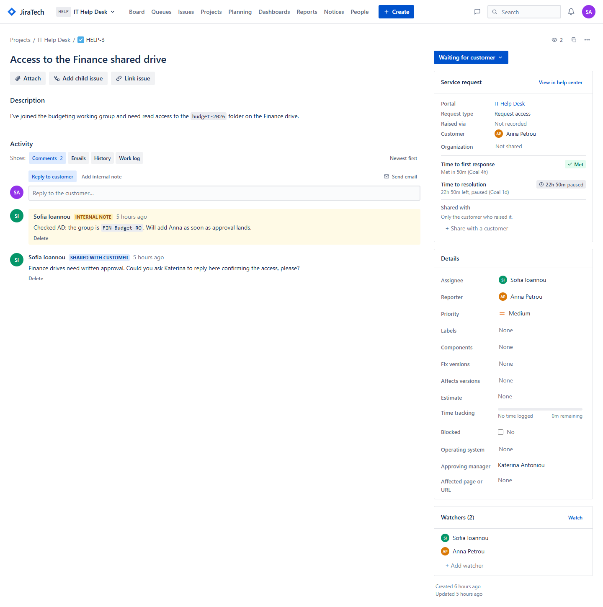

### Customers

Customers are user accounts with the **Customer** role (create them on the **People** page). They only ever see the help center: any other page sends them to it, and the API refuses every agent endpoint for them. They can't be project members or leads, and they don't appear in assignee, watcher or @mention pickers.

### Portals: one team, many client companies

A service desk project can have several **portals**, typically one per client company, so a single team and project can serve many companies, each through its own branded help center. Under *Service desk → Portals* on the project page, *Add portal* creates one with a name and a link (`/portal/acme`); it starts closed. For each portal you set:

- **Who can use it**: organizations and/or individual customers, or *Any customer*. Staff with access to the project can always use it.
- **Request types offered**: all of the project's (the default, including ones added later) or a chosen few.
- **Look and feel**: logo, accent colour and welcome message.

Every portal's requests land in the same project — one set of queues, SLAs and agents — and each request remembers its portal and company (shown on the request panel and as queue columns; JQL `portal = acme`). A project keeps at least one portal; deleting one moves its requests to the first remaining portal. Service desks created before portals existed were given one automatically, linked by their project key (`/portal/HELP` keeps working).

**Organizations** group customer accounts by company: a global admin creates them and adds members under **People → Organizations**, and a service desk's admin links them to portals.

- **Each company sees only its own tickets.** Customers see requests they raised, were added to, or that a colleague shared with their own organization. Another company's requests never appear, even though they're in the same project.
- A customer with access to **one** portal lands straight in it (header, home link and banner in its colours); customers with several see a list of them, each with its logo.
- When raising a request, customers choose **Share with** — their organization (the default) or *No one*. Colleagues in that organization see shared requests under *Requests* and can follow and reply to them. The requester can change this on the request page.
- Agents see the organization on the request panel and in queues, and can change or remove it. Changes are recorded in the history.
- Only global admins change organization membership, because it decides which portals a customer can use.

### The help center (`/portal`)

- **Home**: the portals the customer can use and their open requests.

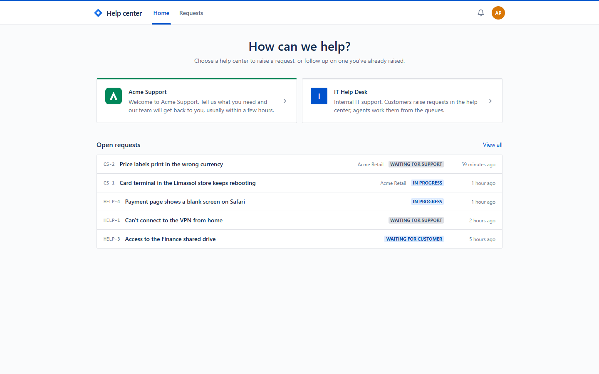

- **A portal**: its logo, colours and welcome message, and the request types it offers.

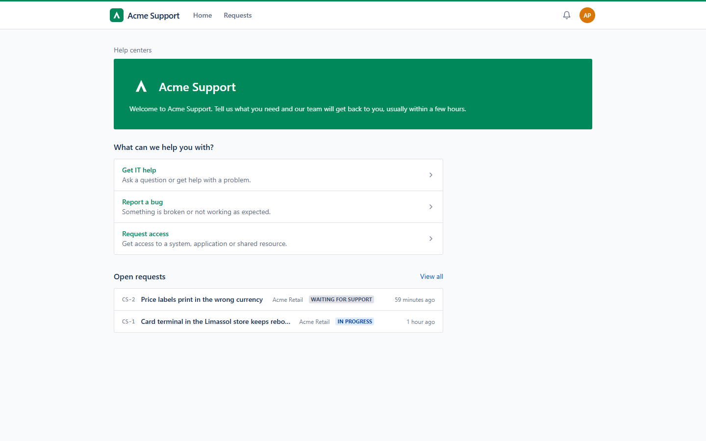

- **Raise a request**: pick a request type, fill in the summary, description and the type's fields, and choose who to share it with.

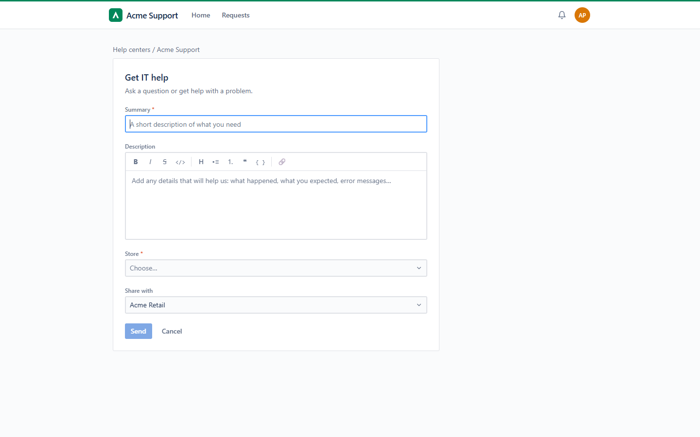

- **Requests**: everything they raised, were added to, or that colleagues shared with their organization, filterable by open/closed.

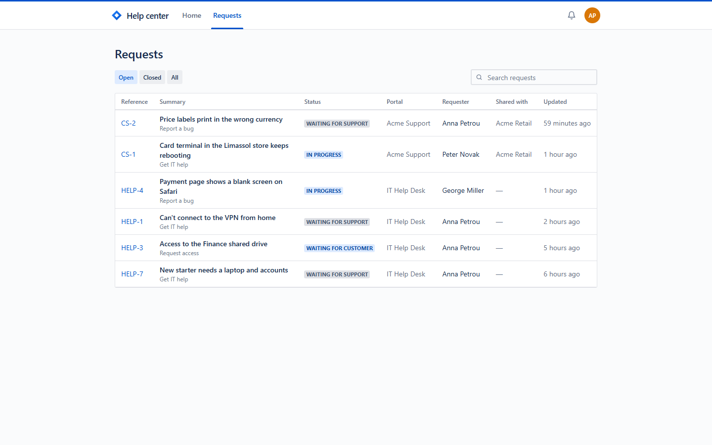

- **A request**: description, field values, the public conversation, status and who it's shared with. Customers reply here; replying to a request that is *waiting for customer* sends it back to the agents automatically.

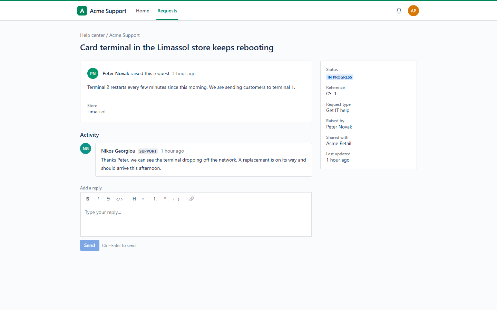

Customers never see internal notes, SLAs, assignees or history. They're notified (in the app and by email, with a link to the request in the help center) when an agent replies publicly or the status changes. Staff can open the help center from the header or the profile menu.

### Email: one address per service desk

Each service desk can have its **own email address** (e.g. `support@acme.com`), set up under *Service desk → Email* on the project page. Conductor reads that address's mailbox over **IMAP** (every minute by default) and:

- turns each **new email** into a request from the sender: the subject becomes the summary, the text the description, and attachments (up to 20 MB each) are attached. It is raised through the portal of the sender's organization; otherwise through the channel's **default portal**, with the chosen **request type** (or the portal's first);
- adds a **reply** to the existing request as a comment when it answers one of the request's emails (its *In-Reply-To* / *References* headers) or the subject carries the request's key, e.g. `Re: [Conductor] (HELP-12) …`. Quoted earlier messages are trimmed. A customer replying to a request *waiting for customer* sends it back to the agents, as on the portal. Only people who can see the request may reply to it;
- keeps each email on the request (shown as an email in its activity) and makes the people in its **To and Cc** request participants: they see the request in the help center, get its updates and can reply. Unknown addresses get a customer account when *Accept emails from anyone* is on; people removed from the request's portal are left out;
- skips out-of-office replies, delivery reports, mailing-list mail and mail from Conductor's own address, so notifications can't loop.

**Accept emails from anyone**: unknown senders get a customer account (no password; an admin can send them a link to choose one from the People page) and access to the default portal. Untick it to accept only existing customers of the service desk — do this when the default portal belongs to one client company. Each address can belong to one service desk only. While the channel is on, emails to customers are sent with it as **Reply-To**.

Admins fill in the mail server, port, security (SSL/TLS or STARTTLS), user name, password and folder, then use *Test connection*, *Turn on* and *Check now*. The password is stored encrypted (key: `MAIL_SECRET`, or `JWT_SECRET`; changing it means re-entering the password) and never sent back to the browser. *Send a test email* runs a made-up email through the channel without a mail server. *Received emails* lists the last 50 emails and what became of each (new request, reply added, ignored or failed, and why). Read emails are marked as read in the mailbox; a message is never handled twice. Microsoft 365 only allows OAuth sign-in over IMAP, which isn't supported yet; Gmail works with an app password. Server settings: `MAIL_POLL_SECONDS` (default 60) and `MAIL_POLLING=false` to stop reading mailboxes (e.g. on a second server instance).

**Mailboxes defined by environment variables.** A desk's email can also be set where the server is hosted (e.g. Render → Environment) with variables named after its project key, so it survives a database reset. They're applied every time the server starts; the password stays in the environment and is never stored in the database. Such a desk shows an *Environment* label and its settings can't be changed or removed in the app, while *Test connection*, *Check now*, *Send a test email* and *Received emails* still work. Removing the variables switches the desk's email off at the next start and makes it editable in the app again. Mistakes (a bad address, an unknown project key, portal or request type) are reported in the server log at startup. For a desk with the key HELP:

| Variable | Value |
|---|---|
| `EMAIL_HELP_ADDRESS` | the address customers write to (required; turns the rest on) |
| `EMAIL_HELP_IMAP_HOST` | e.g. `imap.gmail.com` |
| `EMAIL_HELP_IMAP_PASSWORD` | the mailbox password (Gmail: an app password) |
| `EMAIL_HELP_IMAP_USER` | default: the address |
| `EMAIL_HELP_IMAP_PORT` | default: `993` |
| `EMAIL_HELP_IMAP_SECURE` | default: `true` (SSL/TLS); `false` for STARTTLS |
| `EMAIL_HELP_IMAP_FOLDER` | default: `INBOX` (or a Gmail label) |
| `EMAIL_HELP_PORTAL` | default portal's link name, e.g. `acme` (default: the first portal) |
| `EMAIL_HELP_REQUEST_TYPE` | request type name, e.g. `Report a bug` (default: the portal's first) |
| `EMAIL_HELP_ACCEPT_ANYONE` | default: `true` |
| `EMAIL_HELP_ENABLED` | default: `true` once the server and password are set |

### Emails on a request

A request raised by email says **Raised via: Email** in its *Service request* panel (*Help center* for portal requests). Every email received or sent on it is shown in **Activity** as an email: sender, To, Cc, subject (*Details* shows the full headers), the body as the sender wrote it (earlier quoted messages folded behind **•••**) and its attachments. *Show: Emails* lists only the emails.

- **Reply** answers the sender (or their Reply-To); replying to an email you sent goes to the same people again. **Reply all** (shown when the email went to others too) adds everyone else in To and Cc, except the service desk itself. **Forward** sends it on, with its attachments ticked. **Send email** (next to *Add internal note*, or on the *Emails* tab) starts a new one, to the customer by default.
- The email window has To, Cc and Bcc (type an address and press Enter, or search people, organizations and recipient groups), the subject (always carrying the key, e.g. `Re: [HELP-12] …`), the text, *Include the original message*, and files from the request or uploaded. **Show on the customer's portal** (ticked except for forwards) decides whether it also appears there as a reply or stays an internal note; only public emails make their recipients participants. An unsent draft is kept in the browser until it is sent or discarded.
- The email is sent from the address in Email settings, named after the agent and the desk (e.g. *Anna Smith (IT Help Desk)*), with the desk's address as Reply-To and threading headers, so the answer comes back to the request. Without an enabled email address on the desk the window warns that answers won't come back. People who got the email aren't also sent the usual "commented" notification.
- An email the mail server refused is marked **Not sent**, with the reason and **Try again**. Deleting the comment deletes its email.
- Emails received before this feature existed show as ordinary comments.

**Templates.** Pick one at the top of the email window: its text (and, for a new email, its subject) replaces what you wrote, with the placeholders filled in for the request: `{{customer.name}}`, `{{customer.firstName}}`, `{{customer.email}}` (the first recipient, or the request's customer), `{{agent.name}}`, `{{agent.firstName}}`, `{{agent.email}}`, `{{issue.key}}`, `{{issue.summary}}`, `{{issue.status}}`, `{{issue.priority}}`, `{{issue.assignee}}`, `{{request.type}}`, `{{request.link}}` (the request in the help center) and `{{project.name}}`. Global admins manage **global templates**, offered on every service desk, under *Profile menu → Administration → Email templates*; project admins add a desk's own under *Service desk → Email templates* on the project page (*Insert placeholder* adds them).

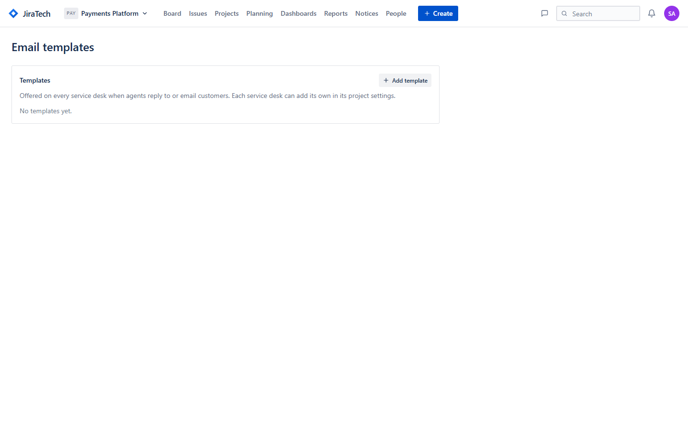

### How SLAs are measured

Both clocks start when the request is raised and run around the clock (no business-hours calendar). *Time to first response* stops at the first public reply from someone other than the requester, or when the request is resolved. *Time to resolution* pauses while the request is in a status that pauses SLAs, stops when it's resolved, and resumes if it's re-opened (the time it spent resolved doesn't count).

---

## 17. Notifications


| You get… | When |
|---|---|
| **Assigned** | Someone assigns an issue to you |
| **Mentioned** | Someone `@mentions` you in a comment or description |
| **Watching** | Someone adds you as a watcher |
| **Commented / Status changed / Updated / Deleted** | An issue you reported, are assigned to or watch changes |

- **Direct** tab: assignments, mentions, watcher invitations. **Watching** tab: everything.
- *Only show unread*, *Mark all as read*, and per-item read/unread.
- You're never notified about your own actions; each change produces at most one notification per person.
- Each notification is also emailed — to the people chosen in the email notification settings (next section) — unless you switch off *Email notifications* in the profile menu.

---

## 18. Email settings and email notifications

### Email settings (global admins)

All outgoing email — notifications of every project, replies to service desk customers, service notices, automation emails and welcome emails — is sent one way, set under **profile menu → Administration → Email settings** (`/settings/email`).

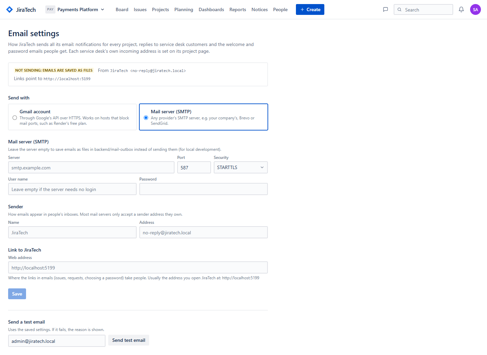

**Send with** chooses how:

- **Gmail account**: sent through Google's Gmail API over HTTPS (port 443), so it works where outgoing mail ports are blocked, such as on Render's free plan or many company networks. Enter the **Client ID** and **Client secret** of a Google Cloud OAuth client, **Save**, then **Connect Gmail account**: Google asks you to choose the account and allow *Send email on your behalf*, then brings you back. Emails are sent from that account (Gmail always uses its address); the **Sender** name still applies. Conductor can only send through it, not read it. **Disconnect** stops using it and revokes the access at Google; changing the Client ID disconnects it too. If Google stops accepting the connection (revoked, password changed, or the app left in *Testing*), *Send test email* says so: connect again. One-time setup in Google Cloud (the page shows these steps and the exact redirect URI to copy):

  1. In [Google Cloud](https://console.cloud.google.com/), signed in as the Gmail account that should send, create a project.
  2. **APIs & Services → Library → Gmail API → Enable**.
  3. **OAuth consent screen**: app name, your email, audience *External* (or *Internal* for Google Workspace), then **Publish app** (*In production*). In *Testing*, Google ends the connection after 7 days.
  4. **Credentials → Create credentials → OAuth client ID → Web application**, with the authorized redirect URI `https://<your address>/api/mail-settings/google/callback` (one per address you use, e.g. your Render URL and `http://localhost:5172`). Email settings shows the exact value with a copy button.
  5. In Email settings choose **Gmail account**, paste the Client ID and secret, **Save**, then **Connect Gmail account** and allow *Send email on your behalf* (for your own unverified app: *Advanced → Go to Conductor*).
- **Mail server (SMTP)**: server, port, security (STARTTLS, usually port 587, or SSL/TLS, port 465), user name and password. The password is stored encrypted (key: `MAIL_SECRET`, or `JWT_SECRET`) and never shown again; leave the field empty to keep it.
- **Sender**: the name and address emails come from. Most servers only accept an address they own.
- **Link to Conductor**: the web address links in emails use (otherwise `APP_URL`, otherwise `http://localhost:5172`).
- **Send a test email** sends one with the saved settings and shows the mail server's reason if it fails (wrong password, wrong port…).

The banner at the top says what is in use. With nothing set there, a Gmail account in the `GMAIL_CLIENT_ID`, `GMAIL_CLIENT_SECRET`, `GMAIL_REFRESH_TOKEN` and `GMAIL_USER` environment variables is used (survives a database reset; see the README for getting the token), then the `SMTP_*` settings in `backend/.env`; with none of them, emails are written as `.eml` files to `backend/mail-outbox/` (local development). Each service desk's own *incoming* address is set separately on its project page ([section 16](#email-one-address-per-service-desk)).

### Who is emailed about issue events

**Profile menu → Administration → Email notifications** (`/settings/notifications`, global admins) chooses, for each issue event, **who gets an email**:

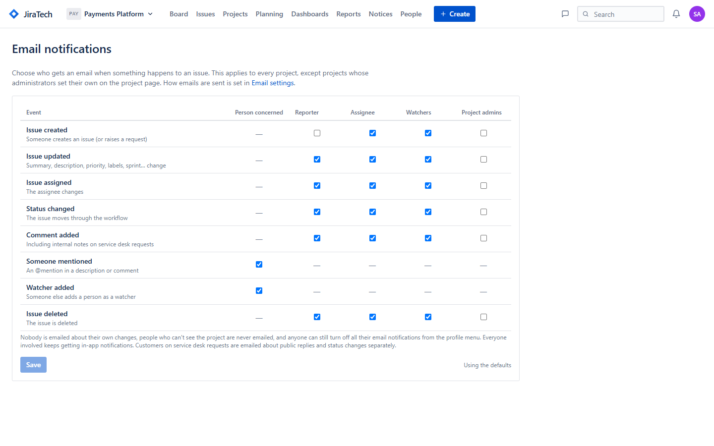

| Events | Recipients you can tick |
|---|---|
| Issue created (or request raised), Issue updated, Issue assigned, Status changed, Comment added (including internal notes), Someone mentioned, Watcher added, Issue deleted | **Person concerned** (the person mentioned, or added as a watcher), **Reporter**, **Assignee** (when the assignee changes, the previous one too), **Watchers**, **Project admins** (the lead and members with the Administrator role) |

- The defaults match what Conductor always sent: reporters, assignees and watchers about every change, and people about being mentioned or added as a watcher. *Reset to defaults* returns to them.
- The settings apply to every project except those whose administrators set their own in the **Email notifications** section of the project page (they can also go back to the global settings).
- They only decide who is **emailed**: everyone involved still gets in-app notifications, nobody is emailed about their own changes or about projects they can't see, and the personal switch in the profile menu still turns all of someone's emails off. Customer emails on service desk requests are unchanged.

---

## 19. Service notices

**Notices** in the header (`/notices`) sends formatted service notifications by email: maintenance reminders, incident notifications and the like.

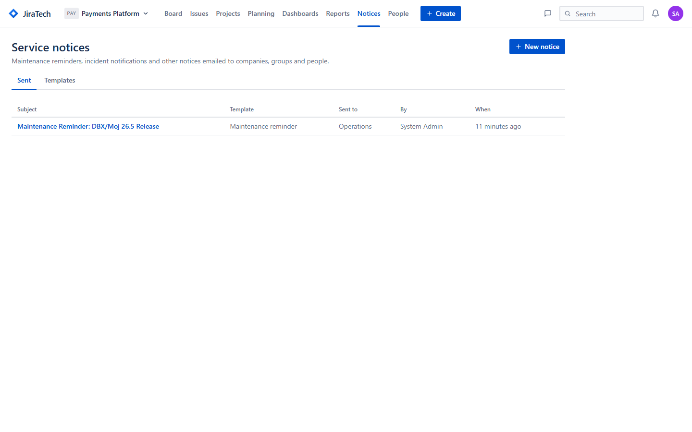

- **New notice** asks for a template (or a blank notice). Every text can then be changed before sending: the header, the title, each section's label and value, and the footer. Sections can be added, removed and reordered (*Field*, *Box of lines* such as Date & Time, *Paragraph*, *Note*, *Small print*). Date and time lines have pickers that write e.g. *Wednesday 12th August 2026*; fields can offer one-click suggested values (e.g. Impact Level *1 / Low*). The preview beside it is the email exactly as it will be sent.

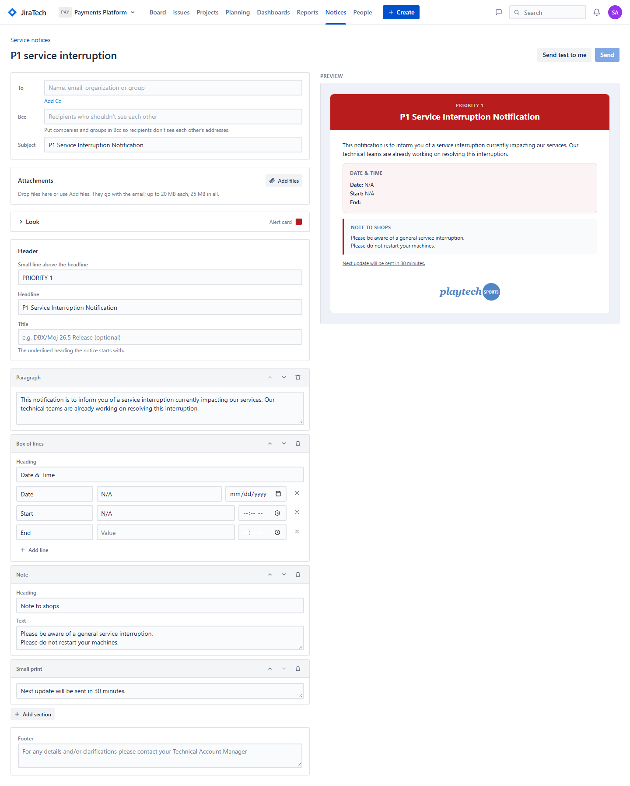

- **To, Cc and Bcc** take people, typed addresses, organizations (companies) and recipient groups; groups and organizations go to everyone in them when it is sent. Put companies in Bcc so recipients don't see each other. *Send test to me* sends it only to you.
- **Attachments**: *Add files* (or drop files on the card) sends files with the email, up to 20 MB each and 25 MB in all. They are listed on the sent notice, and *Send update* starts with the same files (remove any you don't need). Files uploaded for a notice that is never sent are deleted after a day.
- **Sent** lists every notice with who it went to. Opening one shows it as sent; **Send update** starts a new notice with the same content and recipients (e.g. the next P1 update). A notice the mail server refused can be sent again.

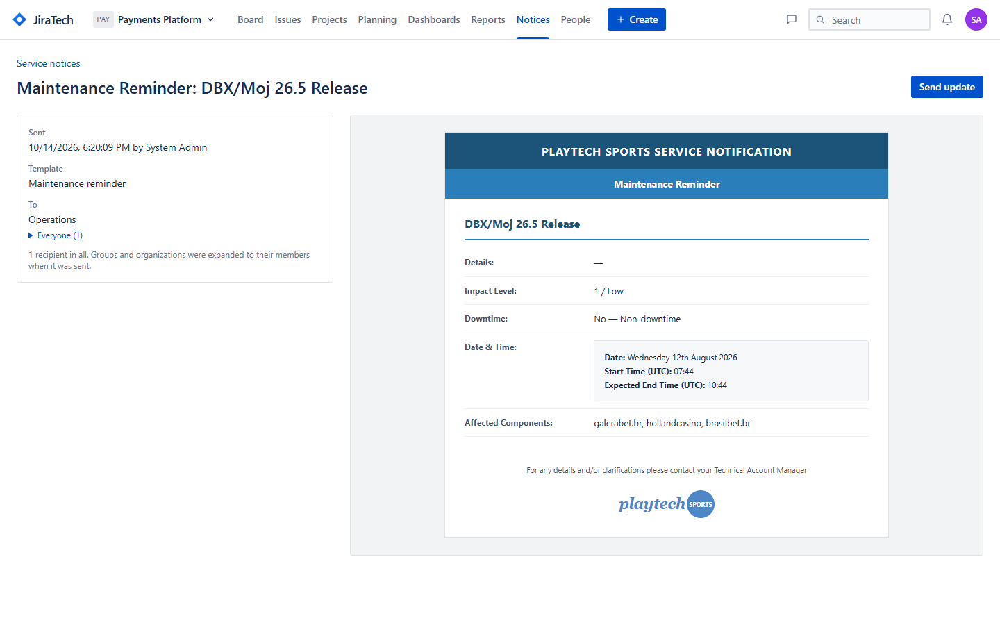

- **Templates** (global admins add, edit, duplicate and delete them) hold the look (*Banner* or *Alert card*, a colour, the logo) and the texts a notice starts with.

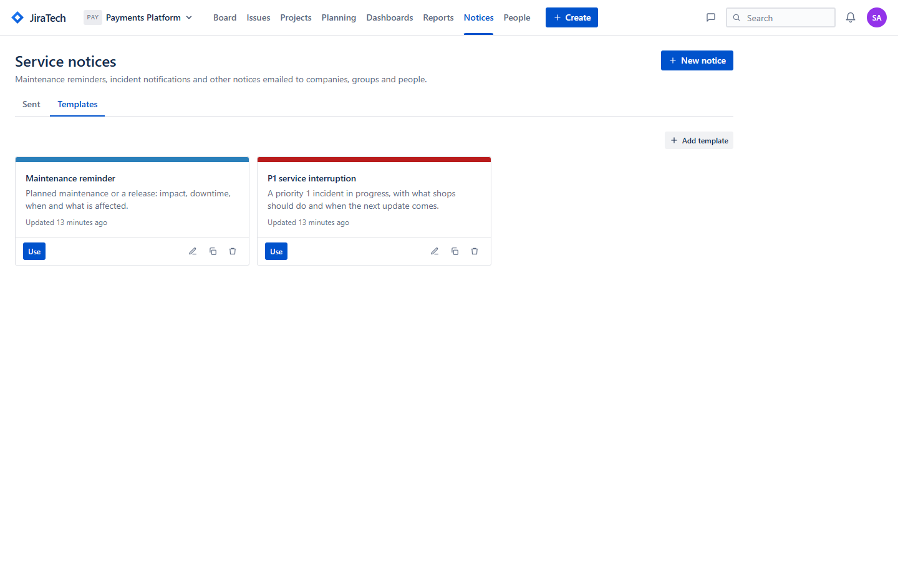

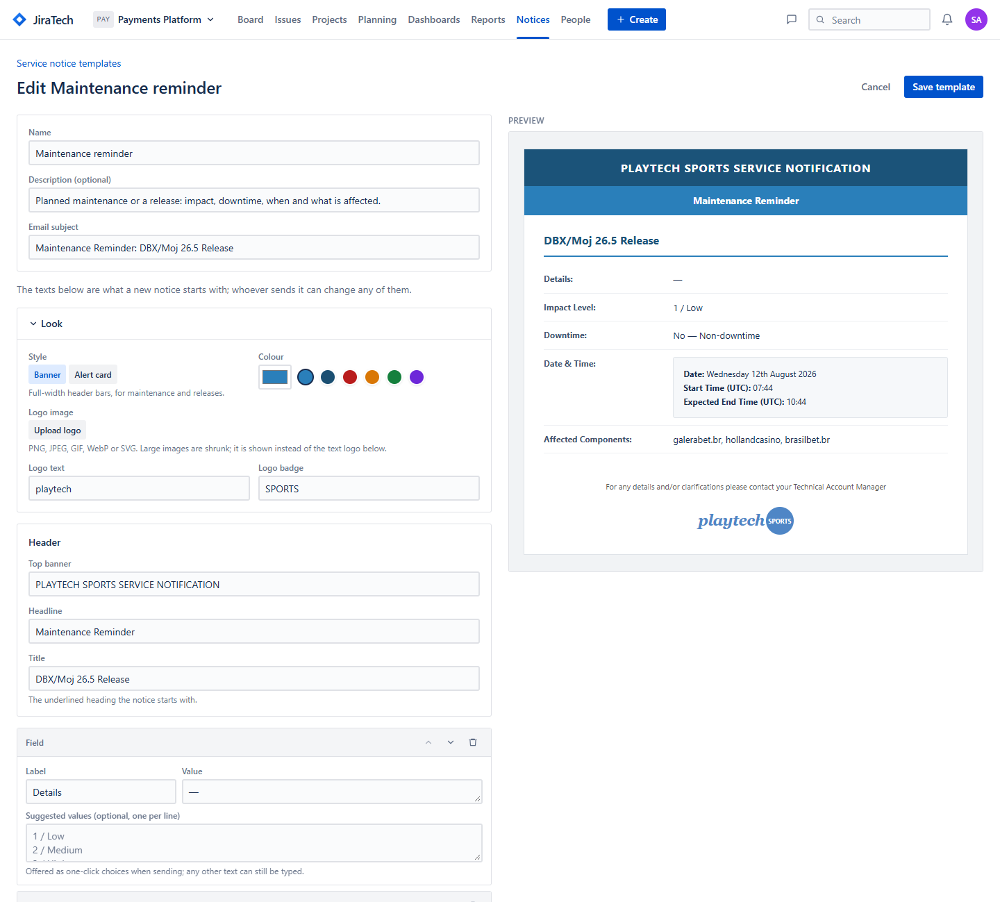

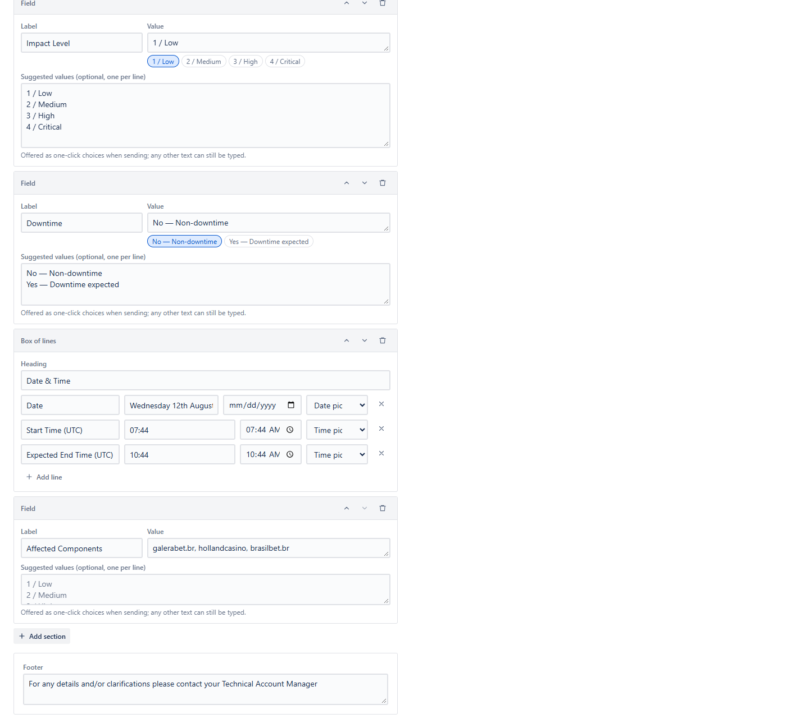

- **Logo**: under *Look*, *Upload logo* takes a PNG, JPEG, GIF, WebP or SVG image (large ones are shrunk; WebP and SVG become PNG) and shows it instead of the text logo, with a *Height* slider. Set it on a template once, or on a single notice. In the email it is sent as an embedded image, so mail clients show it without loading anything from Conductor. A new installation starts with *Maintenance reminder* and *P1 service interruption*.

---

## 20. People, organizations and recipient groups

The **People** page has three tabs: **People**, **Organizations** and **Recipients**.


Everyone who can sign in and be an assignee, reporter or watcher. Search by name or email. Administrators can **Add person** (full name, email, role) and **Edit** people (including sending a password link).

**Welcome emails.** *Add person* sends the new person a **welcome email** (on by default) with a link to choose their own password:

- The link opens **Choose your password** (`/set-password`), which greets them by name. Passwords need at least 8 characters. Saving logs them straight in: staff land on the board, customers in the help center.
- A link works for **7 days** and **once**; sending a new one cancels the previous one. An expired or used link says so and offers *Get a new link* (the *Forgot password?* page, section 4).
- Until they choose a password nobody can log in as them, and the list shows them as **Invited** with **Resend** (a new link).
- **Edit → Email them a link to choose a new password** sends the same kind of link to anyone, e.g. someone who forgot their password. People can also do this themselves with *Forgot password?* on the login page.
- Untick *Send a welcome email* to type a password for them instead (at least 6 characters).
- The email goes out through the **Email settings** (section 18). If it can't be sent, the person is still added and you're told to check the settings and use *Resend*.

Global roles: Admin, Developer, Merge Master, Product Manager, Product Owner, Program Manager, Project Manager, QA Specialist, Release Manager, Scrum Master, Team Lead and **Customer**. **Admin** administers every project and manages people; **Project / Program / Product Manager** can also create projects; **Customer** only uses the help center; the other roles describe the person's job. What someone can do inside a project is set by their **project role** (see section 26).

**Organizations (Organizations tab).** Customer companies, each with its customer accounts. Global admins create them and manage their members; service desk admins link them to portals ([section 16](#portals-one-team-many-client-companies)).

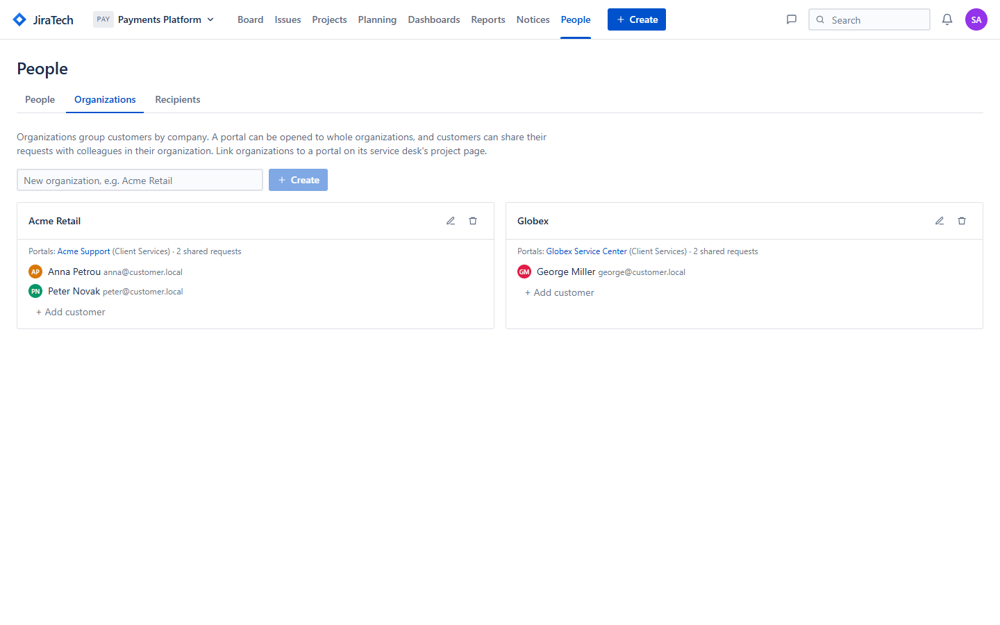

**Recipient groups (Recipients tab).** A recipient group gathers people, whole organizations and other email addresses (people without an account, e.g. a supplier) under one name, such as *All retail customers*. Global admins create, edit and delete them; everyone on staff can see them. In the email window of a service desk request (section 16) and in service notices (section 19), typing in **To, Cc or Bcc** searches people, organizations and recipient groups together. A group or organization becomes one chip, e.g. *All retail customers (12)*, and the email goes to everyone in it at the moment it is sent (an organization's current members). On the request the email reads *To: All retail customers (12)*; *Details* lists everyone. People reached through a group or organization don't become participants of the request; people added one by one still do.

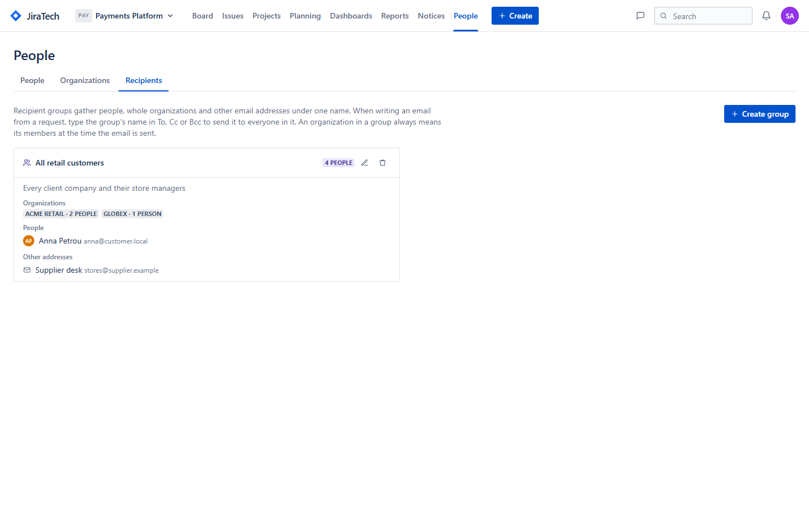

---

## 21. Automation rules

A rule does something when something happens to an issue. Manage rules under **profile menu → Integrations → Automation** (`/settings/automation`): global administrators manage all of them, and project administrators the rules of their own projects ([who can set things up](#who-can-set-up-integrations)).

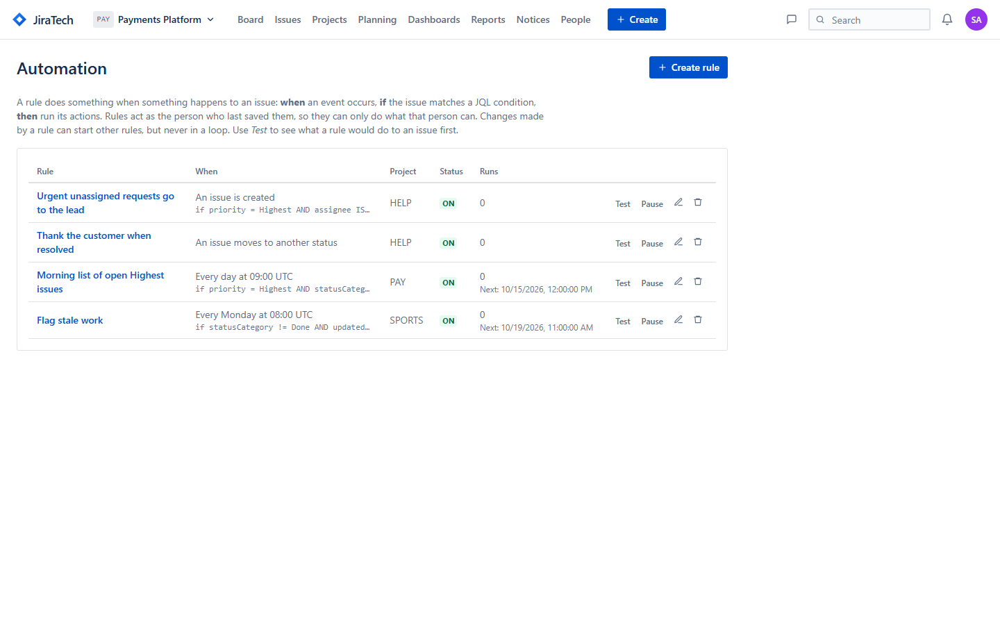

A rule is **when** + **if** + **then**:

| Part | What it is |
|---|---|
| **Project** | One project, or all projects (all projects: global administrators only) |
| **When** | An issue is created, edited, assigned, moves to another status, gets a comment, or **on a schedule**. *Edited* can be limited to chosen fields (e.g. only when the priority changes); *moved* can be limited to one target status |
| **If** (optional) | The issue must match a JQL query, e.g. `priority = Highest AND labels IS EMPTY`. No condition: every issue (scheduled rules need one) |
| **Then** | Up to 10 actions, run in order. If one fails, the rest are skipped and the run is logged as failed |

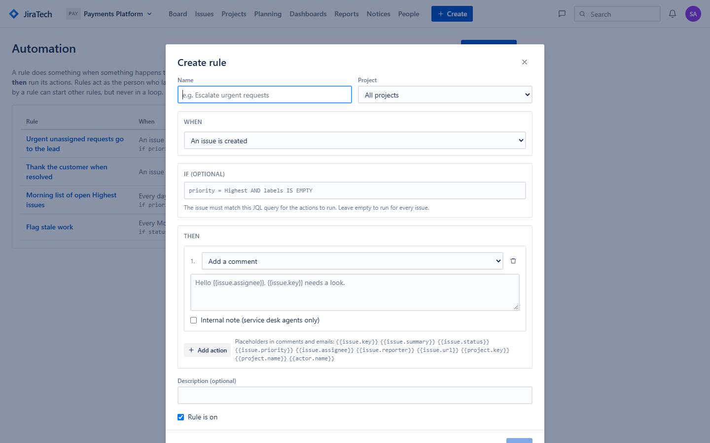

**Actions**

| Action | Notes |
|---|---|
| Assign the issue | To nobody, the reporter, the project lead or a chosen person |
| Set the priority | |
| Move to a status | A status name (`In Progress`) or category (`TO_DO`, `DOING`, `CLOSED`). The workflow must allow the move; closing uses the resolution Completed |
| Add a comment | Optionally an internal note (service desk agents only) |
| Add a label | A single word; created in the project if new |
| Post to chat | A message in a Slack or Teams channel through one of its chat webhooks (section 22) |
| Send an email | To the assignee, reporter or project lead, and/or any addresses (project administrators: only people with a Conductor account). A link to the issue is added |

Comments, chat messages and emails can use placeholders: `{{issue.key}}`, `{{issue.summary}}`, `{{issue.status}}`, `{{issue.priority}}`, `{{issue.assignee}}`, `{{issue.reporter}}`, `{{issue.url}}`, `{{project.key}}`, `{{project.name}}`, `{{actor.name}}` (who caused the event).

Examples:
- *When an issue is created, if `priority = Highest AND assignee IS EMPTY`: assign to the project lead and email them.*
- *When an issue moves to Resolved: add the label `needs-survey` and a comment thanking the customer.*
- *When a comment is added, if `status = "Waiting for customer"`: move to Waiting for support.*

**Scheduled rules.** *On a schedule* runs a rule every hour, day or week (at a time in **UTC**). The JQL condition chooses the issues to act on, and the actions run once on each, up to **100 issues per run**. Make the condition exclude issues already handled, usually by having an action change what the condition looks at, e.g. *daily 09:00, `status != Closed AND updated <= -14d AND labels IS EMPTY`: add the label `stale` and a comment asking for an update.* If the server was down at the scheduled time, the rule runs once when it is back. `AUTOMATION_SCHEDULER=false` stops an instance running schedules.

**Who a rule acts as.** Actions run with the access of the person who last saved the rule (shown as its author), so a rule can never do more than that person could; the change shows in the issue's history under their name. If the author is deleted the rule is switched off until someone opens and saves it.

**Loop protection.** A rule never starts itself through its own changes, chains stop after 3 steps (logged as **Stopped**), and a rule that runs on the same issue more than 5 times within a minute is stopped.

**Testing and history.** **Test** checks a rule against an issue (or, for a scheduled rule with no key, lists the issues it would act on and when it runs next) without doing anything. Click a rule's name for its **run history** (kept 30 days). **Pause** switches a rule off without deleting it.

---

## 22. Webhooks, Slack and Microsoft Teams

**Profile menu → Integrations → Webhooks** (`/settings/webhooks`). A webhook has a name, an address, the events it wants, a project (or all projects), an optional JQL filter and a **format**:

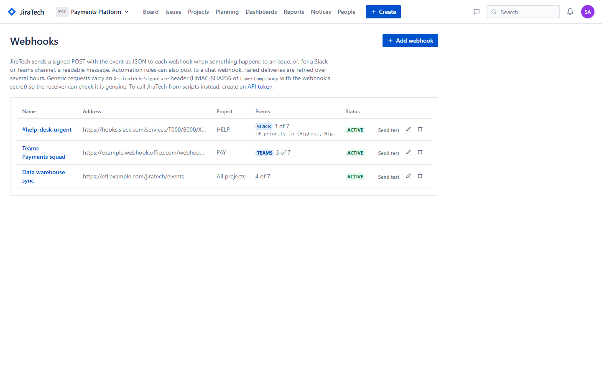

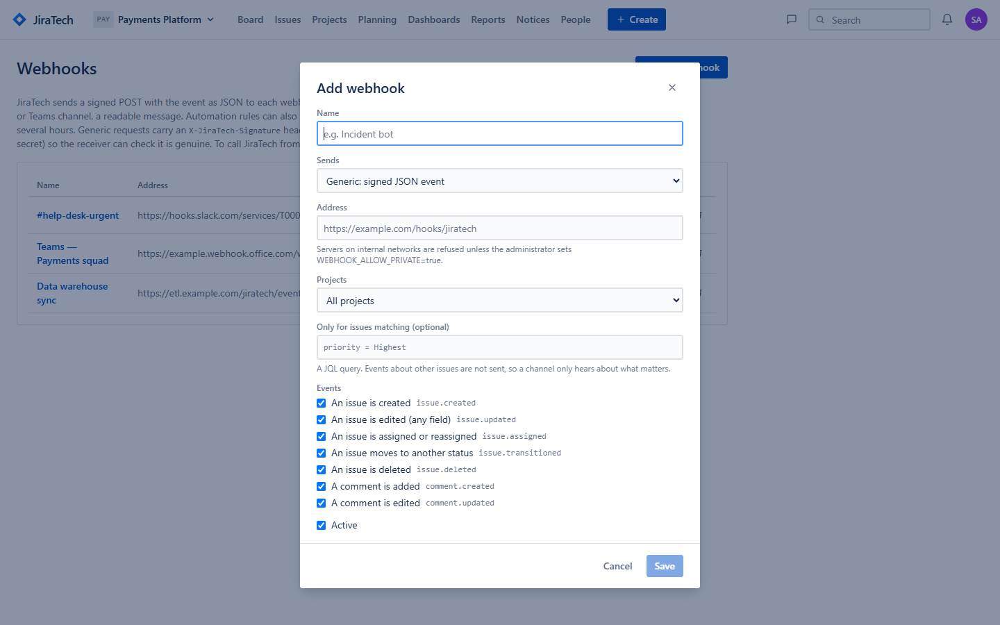

| Format | What is sent |
|---|---|
| **Generic: signed JSON event** | A `POST` with the event, actor, project, issue and changes as JSON, signed with HMAC-SHA256 (`X-Conductor-Signature`) using the webhook's secret (shown once; *New secret…* replaces it) |
| **Slack channel** | A formatted message in the channel (Slack incoming-webhook address) |
| **Microsoft Teams channel** | An Adaptive Card with an **Open** button (Teams *Workflows → Post to a channel when a webhook request is received*) |

**Events**: an issue is created, edited, assigned, moves to another status, is deleted; a comment is added or edited. Bulk changes send events too.

**Filter**: events about issues that don't match the JQL are not sent (checked as the person who last saved the webhook), e.g. a channel for urgent work: `priority = Highest AND status != Closed`. A chat webhook with **no events ticked** only speaks when an automation rule posts to it.

**Chat messages** read like *Ada moved this from To Do to In Progress*, *Ada updated this issue — Priority: Medium → Highest* or *Ada commented* with the comment quoted (internal notes are marked), each with a link to the issue.

**Delivery**: answer with any `2xx` within 10 seconds. Failures are retried after 1 min, 5 min, 30 min, 2 h and 6 h; a webhook that fails 30 times in a row is switched off. Each webhook's name opens its delivery log (14 days) with **Send test** and **Resend**. Webhooks pointing at localhost or private networks are refused unless `WEBHOOK_ALLOW_PRIVATE=true`; `WEBHOOK_WORKER=false` stops an instance doing retries.

Full payload format and signature verification: [docs/API-INTEGRATIONS.md](API-INTEGRATIONS.md) and [docs/CHAT-INTEGRATIONS.md](CHAT-INTEGRATIONS.md).

---

## 23. Incoming webhooks

**Profile menu → Integrations → Incoming webhooks** (`/settings/incoming-webhooks`) lets monitoring and CI tools raise issues by POSTing JSON to a **secret address** (`/api/hooks/jth_…`, shown once; *New address…* replaces it if it leaks).

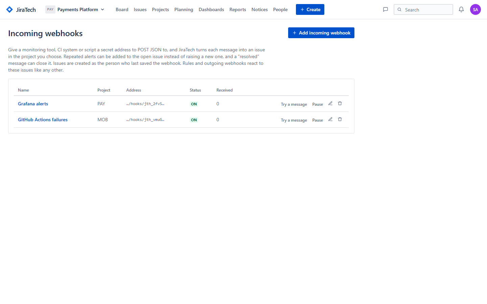

| Setting | |
|---|---|
| **Create issues in** | The project. Issues are created as the person who last saved the webhook |
| **Summary**, **Description** | Templates that take values from the JSON, e.g. `[{{severity}}] {{title}}` or `{{alerts.0.labels.alertname}}`. The received JSON can be added to the description |
| **Issue type**, **Priority**, **Assign to**, **Labels** | Fixed values |
| **Priority from the message** | A template whose result picks the priority: `critical`, `high`, `warning`, `info`, `P1`–`P5`, `sev1`–`sev5`… |
| **Same alert when this is equal** | E.g. `{{alerts.0.fingerprint}}`: while that alert's issue is open, repeats are added as comments instead of new issues |
| **Close the issue when…** | A field and value (e.g. `status` equals `resolved`) close the open issue for the alert, with a comment |

**Try a message** pastes a sample payload and shows what would happen (new issue, comment, close or ignored) without creating anything. Each webhook keeps a 14-day log. Up to 60 requests a minute are accepted per webhook. Works with Grafana / Alertmanager, GitHub Actions, Jenkins, GitLab, Sentry, Datadog, PagerDuty, Uptime Robot and anything else that can send a webhook. Issues created this way go through the normal path, so automation rules and outgoing webhooks react to them.

### Who can set up integrations

| | |
|---|---|
| **Global administrators** | Everything, including webhooks and rules that apply to **every project** |
| **Project administrators** (the project lead, or a member with the Administrator role) | The webhooks, rules and incoming webhooks of **their own projects** only. A rule's email action can't send to addresses outside Conductor. Each project can have up to 20 webhooks, 50 rules and 20 incoming webhooks |

API tokens can't manage any of these: it needs a person who logged in.

---

## 24. API tokens and the API reference

**Profile menu → API tokens** (`/settings/api-tokens`) — every staff user can create up to 25 tokens for scripts. A token acts as its owner, reaching exactly the projects and actions that person can.

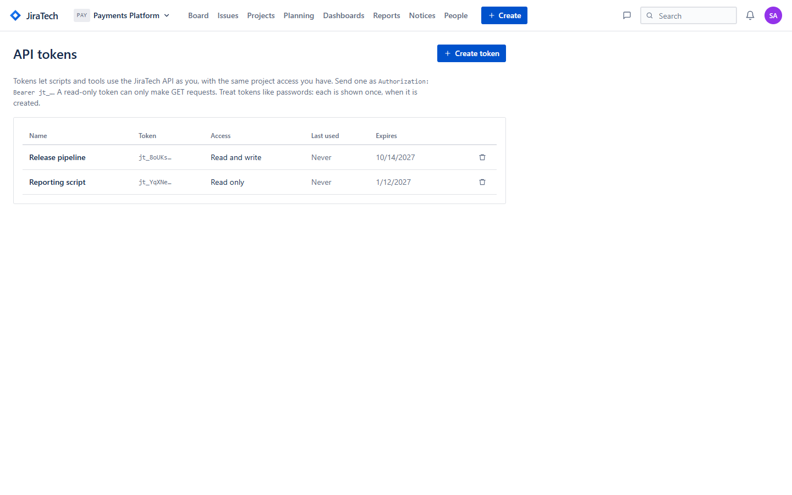

| | |
|---|---|
| **Read only** | Only `GET`, `HEAD` and `OPTIONS` requests |
| **Read and write** | Everything its owner can do, except managing tokens, webhooks and rules |
| **Expires after** | 30 days, 90 days, 1 year or never. An expired or revoked token answers `401` |
| **Storage** | Only a SHA-256 hash is kept; the token (`jt_…`) is shown once, when created. The list shows when each was last used |

```bash
curl -H "Authorization: Bearer jt_xxxxxxxx" https://conductor.example.com/api/issues/HELP-12
```

**API reference.** Every endpoint is described in an OpenAPI 3 document served by Conductor itself: `/api/docs` is an interactive Swagger UI (click **Authorize**, paste a token and use **Try it out**), and `/api/openapi.json` is the machine-readable document for generating clients or importing into Postman. Both are generated from the code at build time, so they match the running version; `API_DOCS=false` switches them off.

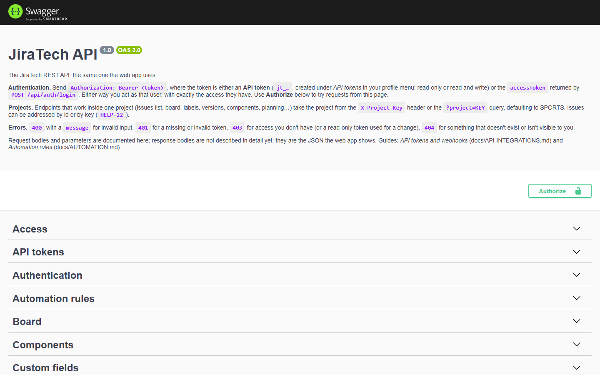

---

## 25. Using Conductor on a phone

Every screen works in a phone browser; there is nothing to install.

| | On a phone |
|---|---|
| **Header** | The navigation folds into a **menu** button (below 1280 px wide); the project switcher shows only the key; Create becomes a **+** button; quick search becomes an icon that opens a full-width search bar |
| **Board** | Columns scroll sideways and snap into place; card edit and ••• buttons stay visible (no hover needed) |
| **Tables** | Issues, queues, reports and settings tables scroll inside their own area instead of widening the page |
| **Issues page** | The filter sidebar folds behind a **Filters** toggle |
| **Layouts** | Side-by-side panels (issue details, dashboards, report charts) stack vertically |
| **Help center** | Customers can raise, follow and reply to requests from a phone |

<div class="phones">

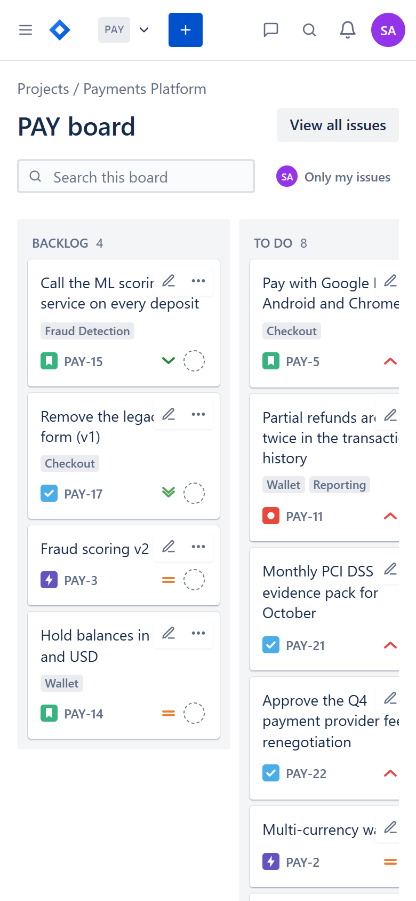

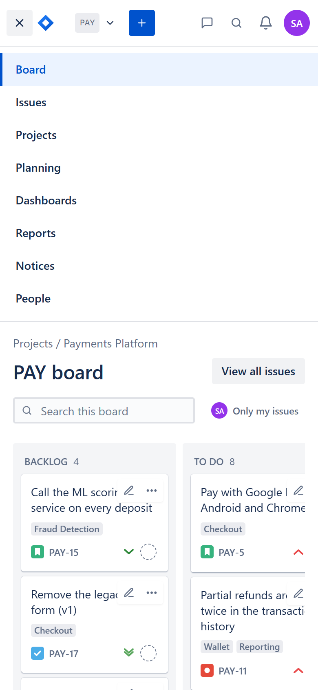

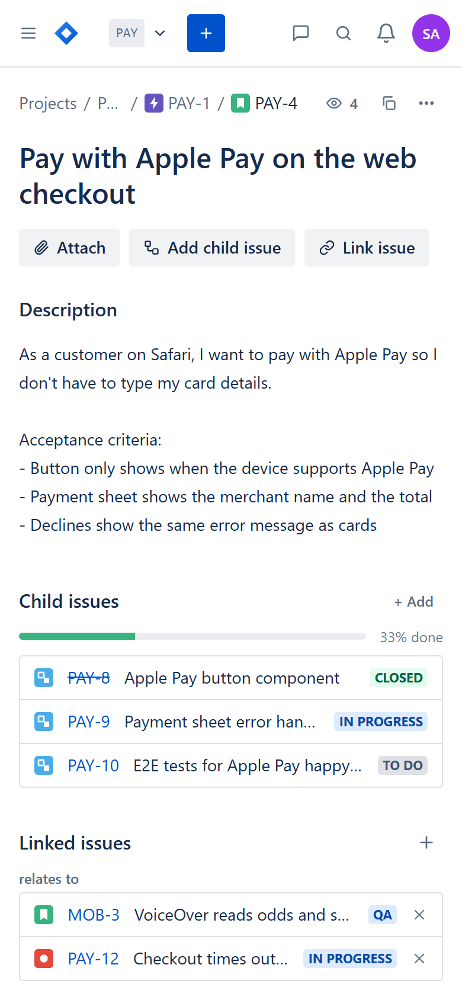

</div>

<div class="phones">

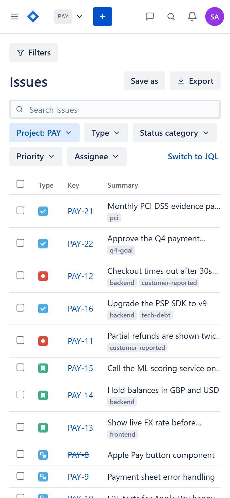

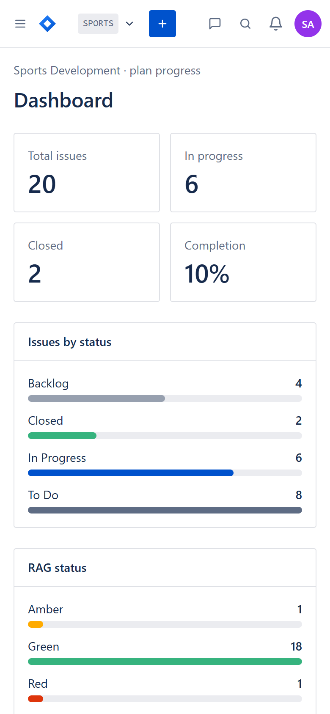

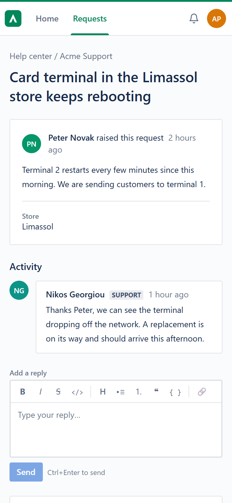

</div>

---

## 26. Permissions reference

Each project has **members** with a role, plus **general access** for everyone else.

| Project role | Can |
|---|---|
| **Administrator** | Everything below, plus project settings, people, versions, components, custom fields, workflow, service desk settings, the project's email notifications, its webhooks, rules and incoming webhooks, and deleting any issue |
| **Member** | Create, edit, assign, link, move and transition issues; log work; delete issues they reported. In a service desk: work requests as an agent |
| **Viewer** | Browse, comment and watch |

| General access | Everyone who isn't a member… |
|---|---|
| **Open** | is a Member |
| **Limited** | is a Viewer |
| **Private** | can't see the project at all |

Global admins and the project lead always administer a project. Search, quick search, boards, links, notifications, webhooks and automation only include what the person (or the rule's author) can see.

| Global capability | Who |
|---|---|
| Create projects | Admin, Project Manager, Program Manager, Product Manager |
| Manage people, organizations and recipient groups | Admin |
| Email settings, global email templates, email notification settings, notice templates | Admin |
| Webhooks, rules and incoming webhooks for all projects | Admin |
| Send service notices, create API tokens | All staff |

**Customers** (the *Customer* role) have no project role at all: they only use the help center, where they see the requests they raised, were added to or that were shared with their organization ([section 16](#16-service-desk-and-help-center)).

---

## 27. JQL reference

```
project = SPORTS AND status != CLOSED ORDER BY priority DESC
assignee = currentUser() AND type IN (Story, Bug)
text ~ "login" AND updated >= -7d
labels IS EMPTY AND (priority = Highest OR priority = High)
project = HELP AND requestType = "Report a bug" AND organization = "Acme Retail"
```

| | |
|---|---|
| **Fields** | project, key, type, status, statusCategory, priority, resolution, assignee, reporter, watcher, labels, component, fixVersion, affectedVersion, sprint, parent, epicName, requestType, organization, portal, summary, description, comment, text, created, updated, blocked |
| **Operators** | `=  !=  ~  !~  >  >=  <  <=  IN  NOT IN  IS [NOT] EMPTY`, combined with `AND / OR / NOT` and parentheses |
| **Functions** | `currentUser()`, `now()`, `startOfDay()`, `startOfWeek()`, `startOfMonth()` |
| **Dates** | `2026-01-31`, `"2026-01-31 14:00"`, or relative `-7d`, `-2w`, `-4h` |
| **Sorting** | `ORDER BY field ASC|DESC` |

JQL is used in search, saved filters, queues, automation conditions and webhook filters.

---

## 28. Capabilities available through the API only

These backend features exist but have no screen yet; they can be called through the REST API (see `/api/docs`):

| Feature | Endpoint |
|---|---|
| List release candidates of a Release Epic | `GET /api/releases/:epicId/candidates` |
| Create a release candidate | `POST /api/releases/:epicId/candidates` |
| Sign off the Golden Master (closes the RC and copies its fix versions to the Release Epic) | `POST /api/releases/candidates/:id/sign-off` |
| Generate release notes (delivered features and bug fixes for the epic's fix versions) | `GET /api/releases/:epicId/notes` |
| De-escalate / Refuse an incident | `POST /api/incidents/:id/escalate` with `action` |

---

## 29. Screen index

| Screen | Route | Screenshot(s) |
|---|---|---|
| Login | `/login` | 01-login |
| Forgot password (no login) | `/forgot-password` | 01b-forgot-password |
| Choose your password (welcome or reset link) | `/set-password?token=…` | 01c-set-password |
| Board, quick actions, side panel | `/`, `/?issue=KEY` | 02-board, 02b-board-quick-actions, 02c-board-side-panel, 19-board-sports |
| Quick search · notifications · profile menu · project switcher | header | 03, 04, 05, 06 |
| Create issue | dialog, `/issues/new` | 07-create-issue |
| Issues — basic, JQL, bulk change | `/search`, `/search?jql=…` | 08, 09, 10 |
| Issue detail, history, work log, move | `/browse/:key` | 11, 12, 13, 13b-move-issue |
| SPORTS issue, release epic | `/browse/:key` | 14-issue-incident, 15-issue-release-epic |
| Projects, create project | `/projects` | 16-projects, 17-create-project |
| Project page | `/projects/:key` | 18-project-page, 18a-project-page-2 |
| Service desk settings | `/projects/:key#service-desk` | 18b, 18c |
| Planning | `/planning` | 20-planning |
| Dashboard | `/dashboard` | 21-dashboard |
| Reports (incl. SLA performance) | `/reports` | 22, 23, 24, 25, 25b-reports-sla |
| People, Organizations, Recipients | `/users`, `/users?tab=…` | 26-people, 26b-organizations, 26c-recipients |
| Page not found | any unknown route | 27-not-found |
| Queues | `/queues` | 30-queues |
| Service request (agent view) | `/browse/:key` | 31-service-request |
| Service notices: sent, templates, compose, view, template editor | `/notices`, `/notices/new`, `/notices/:id`, `/notices/templates/:id` | 40, 41, 42, 43, 44, 44b |
| Email settings · Email templates · Email notifications | `/settings/email`, `/settings/email-templates`, `/settings/notifications` | 50, 51, 52 |
| Automation · rule editor | `/settings/automation` | 60, 61 |
| Webhooks · webhook editor | `/settings/webhooks` | 62, 63 |
| Incoming webhooks | `/settings/incoming-webhooks` | 64 |
| API tokens | `/settings/api-tokens` | 65 |
| API reference | `/api/docs` | 66-api-docs |
| Help center: home, portal, raise, requests, request | `/portal`, `/portal/:slug`, `/portal/:slug/:type`, `/portal/requests`, `/portal/requests/:key` | 70, 71, 72, 73, 74 |
| Phone layouts | any | 80–85 |
